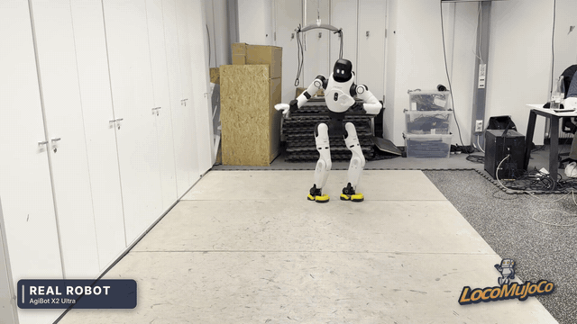

<p align="center">
  
</p>

Real-world deployment protocols for robots trained in
[LocoMuJoCo](https://github.com/robfiras/loco-mujoco). For each robot we provide the
randomizations, observation spaces and rewards it needs, together with training configs and
the tooling to take a policy to the robot.

<p align="center">
  
</p>

## Robots

| | [Unitree G1](deployment/g1/README.md) | [AgiBot X2 Ultra](deployment/x2/README.md) |
|---|---|---|
| environment | `G1Real`, `MjxG1Real` | `X2UltraReal`, `MjxX2UltraReal` |
| export, validation, rollout in plain MuJoCo | yes | yes |
| sim2sim over the robot's middleware | yes, Unitree SDK (DDS) | yes, AimDK (ROS 2) |
| on the robot, from a laptop over Ethernet | yes | yes |
| on the robot's own computer | no example yet | yes, operated over Wi-Fi |

More robots will be added. Every robot is a 29-DoF model with position servos, per-motor
armature and full self-collision, trained on anchored motion tracking, so limb tracking stays
independent of global drift, under the same sim-to-real randomization: pushes, encoder bias,
foot friction, CoM offset, observation noise, and optional observation delay and history.

## Installation

You need a GPU for training.

**1. Install LocoMuJoCo** in editable mode, following
[its installation guide](https://github.com/robfiras/loco-mujoco#installation).

**2. Set up SMPL retargeting**, following
[LocoMuJoCo's SMPL guide](https://github.com/robfiras/loco-mujoco/tree/master/loco_mujoco/smpl).
Clips are retargeted to the robot the first time they are used, which needs the `smpl` extra
and the SMPL-H model. You don't need the AMASS dataset: the source clips download
automatically from
[Hugging Face](https://huggingface.co/datasets/robfiras/loco-mujoco-datasets).

**3. Install this repository** and tell LocoMuJoCo where its robot configs are:

```bash
pip install -e .
```

```bash
loco-mujoco-add-variable --name LOCOMUJOCO_CUSTOM_ROBOT_CONF_PATH --value /path/to/loco-mujoco-real/lmj_real/smpl_robot_confs
```

The browser viewers additionally need `pip install -e '.[viser]'` in `loco-mujoco`.

## Quickstart

Run these from the repository root. `<robot>` is `g1` or `x2`: each robot has its own folder
under `training/`, with its `train.py` and its configs.

**1. Train.** This uses LocoMuJoCo's 19 default clips. Each clip is retargeted to the robot
the first time it is used, then loaded from the cache; that takes a few minutes per clip,
longer for `walk` and `run`, so the first run takes over an hour longer. Results go to
`outputs/`, and metrics go to Weights & Biases. All visible GPUs are used.

```bash
python training/<robot>/train.py
```

Any setting in `training/<robot>/conf.yaml` can be overridden on the command line, for
example to train on fewer clips:

```bash
python training/<robot>/train.py 'experiment.task_factory.params.default_dataset_conf.task=[walk,run]'
```

**Or train with SuperMimic**, LocoMuJoCo's world-model-based tracking algorithm, on the same
environment. The default trains one policy on the 40 LAFAN1 clips for 153 million steps, which
takes about 50 minutes on one 48 GB GPU. Progress is printed and written to `metrics.csv`
in the output directory, and rerunning in the same output directory resumes from the last
checkpoint, `SuperMimicJax_saved.pkl`.

```bash
python training/<robot>/train_supermimic.py
```

The settings are in `training/<robot>/supermimic.yaml`, which lists what it changes in the
environment the PPO recipe uses. The viewer in step 2 reads PPO checkpoints only; the export
in step 3 and everything after it take a `SuperMimicJax_saved.pkl` as well (see
`deployment/REFERENCE.md`).

**2. Watch the policy** in your browser at `http://localhost:8080`.

```bash
python training/eval_viser.py --path outputs/<run>/PPOJax_saved.pkl --visualize-goal
```

**3. Export it** to a bundle that needs only numpy and mujoco, and check that the bundle
reproduces the training environment term by term.

```bash
python deployment/export_bundle.py --checkpoint outputs/<run>/PPOJax_saved.pkl --output deploy_bundles/<name>
```

```bash
python deployment/validate_bundle.py --bundle deploy_bundles/<name> --checkpoint outputs/<run>/PPOJax_saved.pkl
```

**4. Run it in plain MuJoCo.** This checks the export, not the sim-to-real gap: the model is
the one used in training, but the physics is plain MuJoCo instead of MjWarp, and the
observation and the policy are the bundle's own numpy code.

```bash
python deployment/rollout_mujoco.py --bundle deploy_bundles/<name> --viewer
```

**5. Take it to the robot.** From here on the path depends on the robot: its sim2sim
rig, its controller and the procedure on hardware each have their own guide.

> [!WARNING]
> Running a learned policy on a real robot is hazardous. A policy can fail without notice,
> and the robot can fall, hit people or objects, or damage itself. Everything in this
> repository is research code, provided as is and without warranty (see [LICENSE](LICENSE)):
> you deploy at your own risk and are responsible for a safe setup. Hang the robot from a
> crane or gantry, keep people out of its reach, keep the emergency stop in hand, and run
> every policy in sim2sim first.

| robot | guide |
|---|---|
| Unitree G1 | [deployment/g1/README.md](deployment/g1/README.md) |
| AgiBot X2 Ultra | [deployment/x2/README.md](deployment/x2/README.md) |

[deployment/README.md](deployment/README.md) walks through the steps they share.

## Motion data

| source | how to use it | needs |
|---|---|---|
| LocoMuJoCo's default clips | `default_dataset_conf.task`, the default | the SMPL setup above; clips download automatically |
| LAFAN1 | `lafan1_dataset_conf.dataset_name` | nothing else; clips download automatically and are retargeted on first use |
| your own `.lmj.npz` files | `custom_dataset_conf.paths` | trajectories in [LocoMuJoCo's trajectory format](https://loco-mujoco.readthedocs.io/en/latest/source/tutorials/trajectory_interface.html) |
| BONES-SEED | converted to `.lmj.npz`, see below | access to the dataset |

All three keys sit under `experiment.task_factory.params` in `training/<robot>/conf.yaml`.
To train on LAFAN1, replace `default_dataset_conf` there with:

```yaml
      lafan1_dataset_conf:
        dataset_name: [walk1_subject1, dance2_subject4]
```

### BONES-SEED on the G1

[BONES-SEED](https://huggingface.co/datasets/bones-studio/seed) has 142,220 motions, each
already retargeted to the Unitree G1, so they need converting, not retargeting.

**1. Get access.** The dataset is gated: request access on its
[Hugging Face page](https://huggingface.co/datasets/bones-studio/seed) and read
[its licence](https://bones.studio/info/seed-license) first, which limits who may use it.

**2. Download the G1 motions** and extract them. They are one CSV per motion, in
`g1/csv/<date>/<motion>.csv`.

```bash
huggingface-cli download bones-studio/seed --repo-type dataset --local-dir bones-seed --include "g1*" "metadata/*"
```

```bash
tar -xzf bones-seed/g1.tar.gz -C bones-seed
```

**3. Convert** single files or whole folders. `--match` takes a regular expression on the
motion name, and `metadata/` lists every motion with its description.

```bash
python training/g1/bones_to_g1.py bones-seed/g1/csv/220728 --match walk_forward --out data/bones
```

Each motion becomes `data/bones/<motion>.lmj.npz`, resampled to the control rate and
completed with the body and site quantities the reward reads.

**4. Look at one.**

```bash
python training/replay_trajectory.py data/bones/<motion>.lmj.npz
```

**5. Train on them** by listing the files under `custom_dataset_conf.paths` in
`training/g1/conf.yaml`, in place of `default_dataset_conf`.

### BONES-SEED on the X2

An example of using BONES-SEED on the X2 through retargeting will follow soon. Until then,
train the X2 on LAFAN1 with `lafan1_dataset_conf`, which LocoMuJoCo retargets to the X2 on
first use.

## Repository layout

| Path | Contents |
|---|---|
| `lmj_real/environments/` | one environment per robot, with its `Mjx` variant |
| `lmj_real/core/` | control, observations, reward, terminations, randomization, shared by all robots |
| `lmj_real/models/` | the MJCFs and meshes |
| `lmj_real/smpl_robot_confs/` | the retargeting configs |
| `training/` | the PPO and SuperMimic training loops, the viewer and trajectory replay, with a folder per robot for its configs and tools |
| `deployment/` | export, validation and the bundle rollout, with a folder per robot for its sim2sim rig, controller and guide |
| `training/g1/bones_to_g1.py` | converts BONES-SEED G1 motions to trajectories |
| `training/g1/verify_env.py` | behavioural checks on the G1 environment |

## Adding your own robot

`lmj_real` is a minimal copy of LocoMuJoCo's own folder structure: `environments/`,
`core/` with its control functions, observations, rewards, terminal state handlers and domain
randomizers, `models/` and `smpl_robot_confs/`. Everything in it subclasses a LocoMuJoCo
interface and registers itself when `lmj_real` is imported, so a robot is added here without
changing LocoMuJoCo's core.

| what | where |
|---|---|
| the MJCF and meshes | `lmj_real/models/<robot>/` |
| the environment, and its `Mjx` variant | `lmj_real/environments/`, added to `register_environments()` |
| the retargeting config, named after the environment class | `lmj_real/smpl_robot_confs/<ClassName>.yaml` |
| components the robot needs of its own | `lmj_real/core/`, each added to its `register_*()` |
| training configs | `training/<robot>/` |
| controller and guide | `deployment/<robot>/` |

The X2 is the example to follow. Its environment, `lmj_real/environments/x2_ultra_real.py`,
subclasses `G1Real` and overrides only the model path and the body, geom and height
properties; the control function, observations, reward, terminal handler and randomizer read
joint, body and geom names from the environment, so it reuses them unchanged.

## Acknowledgements

The environment design in this repository closely follows the G1 motion-tracking setup of
[mjlab](https://github.com/mujocolab/mjlab), including its model, reward, terminations and
randomization.

mjlab's tracking task continues [BeyondMimic](https://beyondmimic.github.io/)
([paper](https://arxiv.org/abs/2508.08241),
[code](https://github.com/HybridRobotics/whole_body_tracking)), which this work also builds
on. mjlab itself builds on the API design of
[Isaac Lab](https://github.com/isaac-sim/IsaacLab) and on
[MuJoCo Warp](https://github.com/google-deepmind/mujoco_warp).

The X2's deployment follows AgiBot's own examples: the servo gains, the standing pose and
the start and damp conventions come from the `x2_rl_deploy` example of the
[AimDK](https://x2-aimdk.agibot.com/en/latest/), and the model from
[AgibotTech/agibot_x2_urdf](https://github.com/AgibotTech/agibot_x2_urdf). The G1's
controller is built on [unitree_sdk2_python](https://github.com/unitreerobotics/unitree_sdk2_python).

## License

The code is released under the [MIT License](LICENSE). The robot models keep the licences of
their sources, which sit next to them:

| model | source | licence |
|---|---|---|
| `lmj_real/models/g1_real/` | Unitree's G1, as in [MuJoCo Menagerie](https://github.com/google-deepmind/mujoco_menagerie/tree/main/unitree_g1) | [BSD-3-Clause](lmj_real/models/g1_real/LICENSE), Unitree Robotics |
| `lmj_real/models/x2_ultra_real/` | [AgibotTech/agibot_x2_urdf](https://github.com/AgibotTech/agibot_x2_urdf) | [Mulan PSL v2](lmj_real/models/x2_ultra_real/LICENSE) |

No motion data, body models or trained policies are part of this repository. The datasets
and the SMPL model used to make them have licences of their own, some limited to
non-commercial research; check them before you use or share anything derived from them,
trained policies included.
